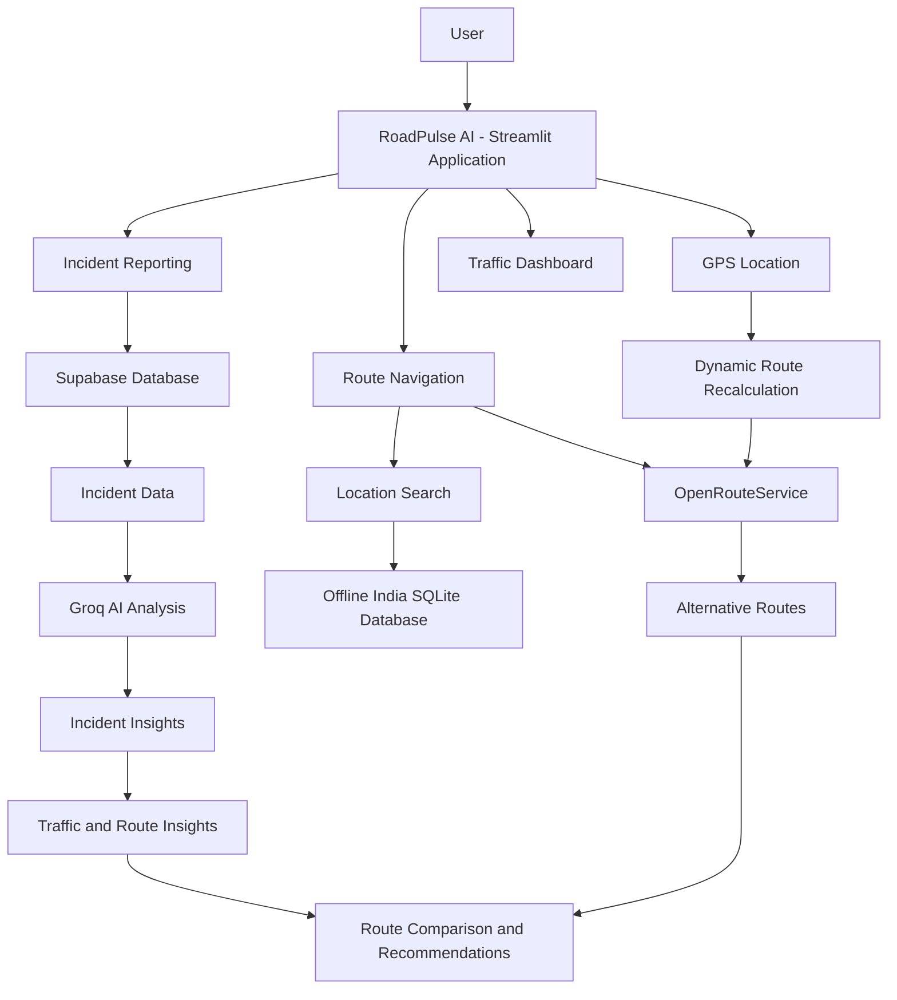

# 🚦 RoadPulse AI – AI-Powered Intelligent Traffic Management System

**RoadPulse AI** is an AI-powered traffic management and route navigation application designed to help drivers make smarter travel decisions. It combines artificial intelligence, community-based traffic incident reporting, geospatial technologies, and intelligent route optimization to improve road safety and travel efficiency.

The application allows users to report traffic incidents, analyze reported incidents using AI, visualize traffic-related information, discover alternative routes, and dynamically recalculate routes using their current GPS location.

The main objective of RoadPulse AI is to develop a smarter, more accessible, and community-driven approach to traffic management, with a focus on addressing traffic challenges in India.

---

## 📌 1. Project Overview

Traffic congestion, road accidents, vehicle breakdowns, road closures, and other unexpected incidents create significant challenges for commuters.

Traditional navigation systems primarily focus on route guidance and estimated travel time. RoadPulse AI aims to extend this functionality by combining community-reported incidents with AI-powered analysis and intelligent route recommendations.

The system provides a platform where users can report road incidents, view reported traffic-related information, and find alternative routes when their planned journey is affected.

Using GPS technology and geospatial routing services, the application can also recalculate a journey from the user's current location to the original destination.

### Main Goals

- Improve traffic awareness through community-based incident reporting.
- Use AI to analyze and understand reported traffic incidents.
- Help drivers identify alternative routes.
- Reduce the impact of unexpected road incidents on journeys.
- Provide dynamic route recalculation using GPS.
- Support location searching across Indian cities and regions.
- Provide a centralized dashboard for traffic incident monitoring and moderation.

---

## ✨ 2. Key Features

### 2.1 Community-Based Traffic Incident Reporting

Users can report traffic-related incidents to inform other commuters.

Examples of reportable incidents include:

- Road accidents
- Traffic congestion
- Road closures
- Vehicle breakdowns
- Construction activities
- Road damage
- Other unexpected road incidents

Community reporting helps build a shared source of traffic-related information.

### 2.2 AI-Powered Incident Analysis

RoadPulse AI integrates artificial intelligence to analyze reported traffic incidents.

The AI component uses the Groq API to process incident information and generate meaningful insights.

It helps interpret incident descriptions and provides structured analysis that can assist users in understanding the reported situation.

**Benefits:**
- Automated incident interpretation.
- Better understanding of reported road conditions.
- AI-assisted traffic incident insights.
- Improved decision-making for commuters.

### 2.3 Traffic Dashboard

The traffic dashboard provides a centralized view of available incident information.

It helps users understand reported traffic conditions and monitor incidents through the application.

The dashboard supports a more organized presentation of community-submitted traffic reports.

### 2.4 Incident Moderation

RoadPulse AI includes an incident moderation mechanism to support the management of community-submitted reports.

Moderation helps administrators review reported information and manage incidents before they are treated as useful information for other users.

This feature is important because community-submitted information may contain incomplete, inaccurate, or duplicate reports.

### 2.5 Intelligent Route Navigation

The route navigation system helps users find routes between a starting location and a destination.

Users can select their starting location through three methods:

- **Manual Search:** Enter a city, area, landmark, or other location.
- **Map Selection:** Select the starting point directly on the interactive map.
- **GPS Location:** Use the browser's location permission to identify the current starting position.

Users can enter their destination and request route calculations.

The application uses OpenRouteService to calculate driving routes and display available route alternatives.

### 2.6 Alternative Route Recommendations

When multiple routes are available, RoadPulse AI helps users compare alternative journeys.

The application considers route information and reported road incidents when calculating and recommending routes.

This helps drivers explore alternative paths instead of relying on a single route.

### 2.7 Road-Closure-Aware Routing

RoadPulse AI incorporates reported road closures into route calculations using supported routing-service avoidance options.

This helps the application identify alternative routes that avoid known reported road closures where supported by the routing service.

### 2.8 Route Risk and Safety Comparison

The application provides route risk and safety comparisons to help users evaluate available alternatives.

This adds another decision-making factor beyond distance and estimated travel time.

### 2.9 AI-Based Route Recommendations

RoadPulse AI uses AI-assisted recommendations to help users understand and compare route alternatives.

The recommendation component provides additional insights to support route selection.

### 2.10 Dynamic Route Recalculation Using GPS

One of the important features of RoadPulse AI is dynamic route recalculation.

If an incident affects the user's current journey, the user can request their current GPS location and calculate a new route to the same destination.

**How it works:**

1. The user initially calculates a route.
2. The application retains the destination.
3. The user requests their current GPS location.
4. The application obtains the browser-provided location after permission is granted.
5. The user initiates route recalculation.
6. A new route is calculated from the current location to the original destination.
7. The updated route is displayed.

This feature helps users adapt their journeys when road conditions change.

### 2.11 India-Focused Location Search

RoadPulse AI includes an offline Indian location-search database.

The application uses a SQLite database (`india_locations.db`) to support searching for Indian populated places.

This improves location discovery and provides an offline location-search resource within the application.

---

## 🧠 3. How RoadPulse AI Works

The application combines several components to provide traffic information and route assistance.

### General Workflow

1. A user submits a traffic incident report.
2. The application stores incident information using Supabase.
3. AI services analyze relevant incident descriptions.
4. The application presents available incident information on its dashboard.
5. Users enter a starting location and destination.
6. The routing engine calculates possible routes.
7. Available incident and road-closure information is considered during route calculations.
8. Alternative routes and route comparisons are presented.
9. Users can request GPS-based dynamic route recalculation when necessary.

### System Architecture



---

## 🛠️ 4. Technologies Used

| Technology | Purpose |
|---|---|
| Python | Main programming language |
| Streamlit | Web application framework |
| Groq API | AI-powered incident analysis and recommendations |
| Supabase | Database and backend services |
| OpenRouteService | Geocoding and route calculations |
| SQLite | Offline Indian location database |
| Folium | Interactive map visualization |
| Streamlit-Folium | Integration of Folium maps with Streamlit |
| Pandas | Data processing and manipulation |
| Requests | API communication |
| Polyline | Route geometry processing |
| Streamlit Geolocation | Browser-based GPS location access |
| GitHub | Source code management |
| Streamlit Community Cloud | Application hosting and deployment |

---

## 🏗️ 5. Project Structure

```text
RoadPulse-AI/
│
├── app.py
│   └── Main Streamlit application
│
├── requirements.txt
│   └── Python dependencies
│
├── .gitignore
│   └── Excludes sensitive and unnecessary files
│
├── .streamlit/
│   ├── config.toml
│   │   └── Streamlit configuration
│   │
│   └── secrets.toml
│       └── Local API credentials (not committed to GitHub)
│
└── data/
    └── india_locations.db
        └── Offline Indian location-search database
```

---

## ⚙️ 6. Installation and Local Setup

Follow these steps to run RoadPulse AI locally.

### Prerequisites

- Python 3.10 or newer (Python 3.11 is a suitable choice).
- Git.
- A Supabase account.
- A Groq API key.
- An OpenRouteService API key.

### Step 1: Clone the Repository

```bash
git clone https://github.com/1ChoudharY0001/RoadPulse-AI.git
```

### Step 2: Navigate to the Project Directory

```bash
cd RoadPulse-AI
```

### Step 3: Install Dependencies

```bash
pip install -r requirements.txt
```

### Step 4: Configure Streamlit Secrets

Create the following directory and file:

```text
.streamlit/secrets.toml
```

Add your credentials:

```toml
SUPABASE_URL = "your_supabase_project_url"
SUPABASE_SECRET_KEY = "your_supabase_secret_key"
GROQ_API_KEY = "your_groq_api_key"
ADMIN_PASSWORD = "your_admin_password"
ORS_API_KEY = "your_openrouteservice_api_key"
```

Replace the example values with your actual credentials.

**Important:** Never upload `secrets.toml`, API keys, or passwords to a public GitHub repository.

### Step 5: Run the Application

```bash
streamlit run app.py
```

The application will start locally and provide a browser URL.

---

## 🔑 7. API Configuration

RoadPulse AI integrates external services to support its functionality.

### Supabase

Used for backend data storage and application database operations.

### Groq API

Used for AI-powered processing, incident analysis, and route recommendations.

### OpenRouteService

Used for:
- Geocoding locations.
- Calculating driving routes.
- Generating alternative routes.
- Supporting road-closure-aware routing.

### Browser Geolocation

The Streamlit Geolocation component requests location access through the user's browser.

GPS functionality requires user permission and a supported browser environment.

---

## ☁️ 8. Deployment

RoadPulse AI is deployed using **Streamlit Community Cloud**.

The deployment process uses GitHub as the source-code repository.

### Deployment Configuration

| Setting | Value |
|---|---|
| Platform | Streamlit Community Cloud |
| Repository | `1ChoudharY0001/RoadPulse-AI` |
| Branch | `main` |
| Main file | `app.py` |

### Deployment Steps

1. Push the application source code to GitHub.
2. Open Streamlit Community Cloud.
3. Connect your GitHub account.
4. Create a new application.
5. Select the RoadPulse-AI repository.
6. Select the `main` branch.
7. Set the main file path to `app.py`.
8. Add the required credentials in Streamlit Secrets.
9. Deploy the application.

Streamlit Community Cloud automatically installs the dependencies listed in `requirements.txt`.

---

## 🔐 9. Security and Privacy

RoadPulse AI uses external APIs and backend services, so protecting credentials and user information is important.

Security considerations include:

- API keys are stored using Streamlit Secrets.
- Sensitive credentials are excluded through `.gitignore`.
- Users must grant browser permission before GPS location can be accessed.
- Community-submitted incident reports should be reviewed and moderated.
- Administrative functionality is protected through an administrator password.

Users should avoid sharing sensitive credentials or publishing private configuration files.

---

## ⚠️ 10. Current Scope and Limitations

RoadPulse AI is a prototype of an AI-assisted traffic management and route navigation system.

Its current capabilities should be understood within the following limitations:

- Traffic incident information depends on available community-submitted reports.
- It does not currently track every vehicle across India.
- It does not provide verified nationwide live traffic data.
- GPS location is obtained from the user's browser only after permission is granted.
- Route calculations depend on OpenRouteService availability and supported routing data.
- AI-generated analysis and recommendations should be treated as assistance, not verified traffic authority information.
- Incident accuracy depends on the quality and moderation of submitted reports.

These limitations provide opportunities for future development and integration with additional traffic data sources.

---

## 🚀 11. Future Enhancements

RoadPulse AI can be extended with additional intelligent traffic-management capabilities.

Potential future improvements include:

1. **Real-Time Traffic Data Integration:** Integrate reliable live traffic feeds from supported traffic-data providers.
2. **Traffic Congestion Prediction:** Apply machine learning models to historical and live traffic information.
3. **Accident Hotspot Detection:** Identify accident-prone areas using historical incident records.
4. **Smart Traffic Signal Optimization:** Explore AI-based traffic signal timing and optimization.
5. **Vehicle Density Estimation:** Use camera feeds or supported traffic sensors to estimate road congestion.
6. **Mobile Application:** Develop an Android and iOS application for easier access.
7. **Voice-Based Navigation:** Provide voice instructions and incident alerts.
8. **Advanced Route Optimization:** Improve route recommendations using travel time, incident severity, and road conditions.
9. **Multilingual Support:** Support multiple Indian languages.
10. **Government and Traffic Authority Integration:** Explore partnerships and verified data integrations.

---

## 🎯 12. Project Impact

RoadPulse AI demonstrates how artificial intelligence, geospatial technologies, community participation, and cloud computing can be combined to address practical transportation challenges.

The project aims to:

- Improve road and traffic awareness.
- Help commuters make informed route decisions.
- Encourage community participation in reporting incidents.
- Support more adaptive route navigation.
- Demonstrate the practical use of AI in intelligent transportation systems.

---

## 👨‍💻 13. Project Information

**Project Name:** RoadPulse AI

**Category:** Artificial Intelligence / Intelligent Transportation System

**Domain:** Traffic Management and Smart Mobility

**Primary Language:** Python

**Application Framework:** Streamlit

**Deployment:** Streamlit Community Cloud

**Source Code:** [GitHub – RoadPulse AI](https://github.com/1ChoudharY0001/RoadPulse-AI)

---

## 🏁 Conclusion

RoadPulse AI is an AI-powered traffic management and route navigation project that brings together intelligent incident analysis, community-driven reporting, interactive maps, alternative route calculations, and GPS-based dynamic route recalculation.

By combining these technologies into a single application, RoadPulse AI demonstrates a practical approach toward smarter and more adaptive transportation solutions.

**Our vision is to make journeys smarter, safer, and more informed through AI and technology.**

### 🚦 RoadPulse AI – Smarter Routes. Safer Journeys. Intelligent Traffic.
